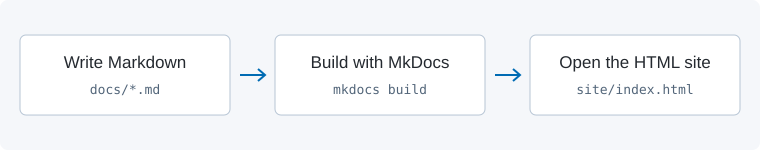

# Links, images, and downloads

Use relative paths for links inside your documentation. MkDocs translates links to Markdown source files into links to the generated HTML.

## A basic link

A Markdown link has a label in square brackets and a destination in parentheses.

**Write this in this page:**

~~~markdown
[Read the installation guide](installation.md)
~~~

**Result:** [Read the installation guide](installation.md).

This file is <code>docs/guide/links.md</code>. Its destination, <code>docs/guide/installation.md</code>, is in the same directory.

## Relative paths

Start a link path at the directory containing the current Markdown page. Each <code>../</code> means “go up one directory.”

From this page:

| Destination | Markdown source path |
| --- | --- |
| A page beside this one | <code>installation.md</code> |
| The homepage, one level up | <code>../index.md</code> |
| A page inside another directory | <code>../reference/math.md</code> |
| A heading on another page | <code>../reference/math.md#matrices</code> |

**Write this:**

~~~markdown
[Homepage](../index.md)
[Mathematics](../reference/math.md)
[Matrix examples](../reference/math.md#matrices)
~~~

**Result:** [Homepage](../index.md) · [Mathematics](../reference/math.md) · [Matrix examples](../reference/math.md#matrices).

Use forward slashes in Markdown links on Windows as well as Linux. Do not use machine-specific paths such as <code>D:\...</code>, <code>/home/...</code>, or a leading <code>/</code> for internal documentation links.

## Link to a heading

Headings get IDs that can be used after a <code>#</code>. For a simple heading named <code>## Relative paths</code>, the generated ID is <code>relative-paths</code>.

**Write this:**

~~~markdown
[Relative path examples](#relative-paths)
~~~

**Result:** [Relative path examples](#relative-paths).

For headings with punctuation, repeated titles, or non-ASCII characters, check the generated heading link instead of guessing its ID. Hover over a heading and use its paragraph-sign permalink, or copy its table-of-contents link.

## Choose a stable heading ID { #stable-link-example }

An explicit ID keeps existing links working even if you change the visible heading text.

**Write this:**

~~~markdown
## Choose a stable heading ID { #stable-link-example }

[Jump to the stable heading](#stable-link-example)
~~~

**Result:** [Jump to the stable heading](#stable-link-example).

The <code>attr_list</code> extension is already enabled in this project. Keep IDs unique within each page and choose simple names using lowercase letters and hyphens.

## Reference-style links

Use a named reference when several sentences point to the same destination.

**Write this:**

~~~markdown
Start with the [authoring walkthrough][authoring].
Return to the [same guide][authoring] whenever you add a page.

[authoring]: authoring.md
~~~

**Result:** Start with the [authoring walkthrough][authoring]. Return to the [same guide][authoring] whenever you add a page.

[authoring]: authoring.md

## Local images

Image syntax adds an exclamation mark before a link. The text in square brackets describes the image for readers who cannot see it.

This example image is included in the project at <code>docs/images/writing-workflow.svg</code>.

**Write this:**

~~~markdown

~~~

**Result:**

MkDocs copies local image files into the built site. Keep the whole site directory when transferring it.

## Local downloads

Put downloadable files under <code>docs/</code>, then link to them just like another resource.

**Write this:**

~~~markdown
[Open the example YAML configuration](../downloads/example-config.yml)
~~~

**Result:** [Open the example YAML configuration](../downloads/example-config.yml).

Depending on the browser, the file may display as text or download. Readers can use “Save link as” to keep a copy.

## External links

An ordinary external hyperlink is allowed:

~~~markdown
[MkDocs website](https://www.mkdocs.org/)
~~~

**Result:** [MkDocs website](https://www.mkdocs.org/) — requires network access when followed.

The site does not fetch that destination just to display the link. Remote images, styles, scripts, and embedded frames are different: they would make the page depend on external resources. Keep those resources local.

## What happens during a build

This project sets <code>use_directory_urls: false</code>. A source link from this page to <code>../reference/math.md#matrices</code> becomes <code>../reference/math.html#matrices</code> in the output.

Write links to <code>.md</code> files while authoring. Let MkDocs produce the <code>.html</code> filenames so its link checks can understand the source documents.

## Check your links

~~~bash
python -m mkdocs build --strict
python tools/check-site.py site
~~~

Then open the built page and click its links. Check capitalization carefully: a filename that works on Windows can fail on Linux if its case differs.
